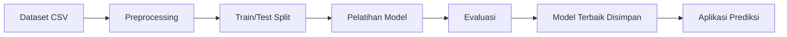

# Ekstraksi Fakta dari Kodingan

Tujuan: mengubah kode dan output menjadi catatan fakta (evidence ledger) yang siap dipakai menulis tiap subbab. Catat selalu **sumbernya** (file, nomor sel/baris) agar mudah diverifikasi.

Daftar isi:
- Membaca notebook dan script
- Pola kode → fakta → subbab
- Membaca aplikasi (backend/frontend/DB)
- Menjalankan kode dengan aman
- Format catatan fakta
- Masalah kode yang perlu dilaporkan

---

## Membaca notebook dan script

- `.ipynb` adalah JSON. Ekstrak sel kode, markdown, **dan output** (angka, tabel, gambar). Contoh:
  ```python
  import json
  nb = json.load(open("file.ipynb", encoding="utf-8"))
  for i, c in enumerate(nb["cells"]):
      print(f"--- [{i}] {c['cell_type']}")
      print("".join(c["source"]))
      for o in c.get("outputs", []):
          txt = o.get("text") or o.get("data", {}).get("text/plain")
          if txt: print(">>", "".join(txt)[:1500])
  ```
- Sel markdown sering berisi penjelasan tujuan dan kesimpulan penulis; gunakan sebagai petunjuk niat, tetapi verifikasi dengan kode.
- Bila ada beberapa versi notebook/script (mis. `v1`, `final`, `copy`), pakai yang paling akhir/utama dan konfirmasi ke pengguna bila ambigu.
- Urutan eksekusi di notebook menunjukkan urutan tahap CRISP-DM yang sebenarnya.
- Hasil yang tidak ada di output (sel belum dijalankan, output dihapus) → lihat "Menjalankan kode dengan aman", atau tandai placeholder.

## Pola kode → fakta → subbab

| Yang dicari di kode | Fakta yang dicatat | Dipakai di |
|---|---|---|
| `pd.read_csv/read_excel`, `load_dataset`, path file di `data/` | nama file, format, sumber (dari komentar/README/URL) | 3.3, 3.4, 4.1 |
| `df.shape`, `df.info()`, `df.dtypes`, `df.columns` | jumlah baris/kolom, tipe, nama atribut | 3.4, 4.2.1 |
| `df.describe()`, `value_counts()`, `df.isnull().sum()`, `duplicated()` | statistik, distribusi target, missing, duplikat | 4.2.2, 4.2.4, 4.3 |
| `plt.*`, `sns.*`, `px.*`, gambar tersimpan | jenis visualisasi dan apa yang ditunjukkan | 4.2.3, 4.5 |
| `dropna`, `fillna`, `SimpleImputer`, `KNNImputer` | cara penanganan missing | 3.2.3, 4.3 |
| `drop_duplicates` | penghapusan duplikat | 4.3 |
| IQR/z-score, `clip`, `RobustScaler` | penanganan outlier | 4.3 |
| `LabelEncoder`, `OneHotEncoder`, `get_dummies`, `OrdinalEncoder` | encoding kategorikal | 4.3 |
| `StandardScaler`, `MinMaxScaler`, `Normalizer` | normalisasi/standardisasi | 4.3 |
| `SelectKBest`, `RFE`, `PCA`, `feature_importances_`, drop kolom | seleksi/ekstraksi fitur dan alasannya | 3.2.3, 4.3 |
| TF-IDF, tokenizer, stemming (Sastrawi), stopwords | pipeline teks | 2.5, 4.3 |
| `SMOTE`, `RandomOverSampler`, `class_weight` | penanganan imbalance | 2.5, 4.3 |
| `train_test_split(test_size, random_state, stratify)`, `KFold` | rasio split, seed, stratifikasi, jumlah data tiap bagian | 4.3 |
| `LogisticRegression`, `RandomForest…`, `XGB…`, `SVC`, `KNN…`, `KMeans`, `LinearRegression`, `Sequential` (Keras), dsb. | algoritma + **seluruh hyperparameter eksplisit** | 2.5, 4.4 |
| `GridSearchCV`, `RandomizedSearchCV`, `optuna` | ruang pencarian, `cv`, `scoring`, parameter terbaik | 3.2.4, 4.4 |
| `accuracy_score`, `classification_report`, `confusion_matrix`, `mean_squared_error`, `r2_score`, `silhouette_score` | metrik yang dipakai dan nilainya | 2.6, 4.5 |
| `joblib.dump`, `pickle.dump`, `model.save` | bentuk model yang disimpan (deployment) | 3.2.6 |
| `requirements.txt`, `import …`, `__version__` | library dan versi | 2.7, 3.5 |
| `random_state`/`seed` | reprodusibilitas | 4.3, 4.4 |

Catatan penting:
- Jika hyperparameter tidak ditulis, algoritma memakai **default library**; tulis "parameter default scikit-learn" dan, bila perlu, sebut nilai defaultnya yang relevan setelah dicek.
- Bedakan jumlah data **sebelum dan sesudah** preprocessing; makalah harus konsisten dengan keduanya.
- Metrik pada data train dan test berbeda; laporkan metrik test sebagai hasil utama, dan sebut train bila dibahas untuk overfitting.

## Membaca aplikasi (backend/frontend/DB)

| Yang dicari | Dipakai di |
|---|---|
| Framework (Flask, FastAPI, Django, Streamlit, Express, Laravel, React, Next.js), struktur folder | 2.7, 3.6 |
| Route/endpoint (`@app.route`, `router.get`), method, input/output | 3.6, 3.7, 4.7, 4.8 |
| Template/halaman (`templates/*.html`, `pages/`, komponen) | 4.7.1–4.7.5 (nama halaman dan fiturnya) |
| Model database (SQLAlchemy/Django models, migration, `schema.sql`, Prisma) | ERD di 3.7, 3.6 |
| Autentikasi/peran pengguna | Use Case di 3.7 |
| Pemanggilan model (`model.predict`) di endpoint | alur prediksi di 3.6, 4.7.4 |
| Upload/unduh file, ekspor laporan (PDF/CSV) | 4.7.2, 4.7.5 |
| `Dockerfile`, konfigurasi hosting, `.env.example` | 3.2.6, 3.5 |
| Folder `tests/` atau file test | 4.8 |

Turunkan diagram dari kode yang sebenarnya:
- **Use Case**: aktor (pengguna/admin) × fitur yang ada di route/halaman.
- **Activity/Flowchart**: alur pada fungsi utama (upload → preprocessing → prediksi → tampil hasil) atau alur pipeline notebook.
- **DFD**: aliran data antar proses, penyimpanan, dan entitas luar.
- **ERD**: tabel, kolom kunci, dan relasi dari model database.
- **Arsitektur**: lapisan (UI, backend, DB, model) sesuai struktur folder.

Contoh Mermaid untuk pipeline:


## Menjalankan kode dengan aman

Jalankan hanya bila hasil diperlukan dan belum ada di output.

1. Salin proyek ke `/home/claude` (folder unggahan bersifat read-only).
2. Periksa kode dahulu: jangan menjalankan skrip yang menghapus file, mengakses jaringan tak dikenal, atau membutuhkan kredensial.
3. Pasang dependensi dengan `pip install … --break-system-packages`. Jaringan sandbox terbatas; dataset yang harus diunduh dari domain lain mungkin tidak tersedia.
4. Gunakan `random_state` yang sama seperti di kode agar hasil sebanding. Jika hasil berbeda dari output notebook asli, **laporkan angka dari notebook asli** dan catat selisihnya ke pengguna.
5. Batasi waktu eksekusi; untuk deep learning besar, jangan dilatih ulang—tandai placeholder.
6. Hasil yang dijalankan ulang harus diberi label di catatan fakta ("hasil eksekusi ulang").

## Format catatan fakta

Simpan di file kerja (mis. `/home/claude/fakta.md`) dengan pola:

```
## Dataset
- Nama: Telco Customer Churn  [sumber: data/telco.csv, README baris 5]
- Baris x kolom: 7043 x 21     [sumber: notebook sel 3 output]
- Target: Churn (Yes/No)       [sumber: sel 12]
## Preprocessing
1. Hapus 11 baris TotalCharges kosong  [sel 8]
...
## Model
- RandomForestClassifier(n_estimators=200, max_depth=10, random_state=42) [sel 21]
## Evaluasi
- RF: acc 0.81, f1 0.78 (data uji 1409 baris) [sel 22 output]
## Belum ditemukan
- Spesifikasi perangkat keras; metadata kelompok; screenshot
```
Bagian "Belum ditemukan" menjadi daftar tindak lanjut di akhir.

## Masalah kode yang perlu dilaporkan

Saat membaca, perhatikan dan sampaikan secara jujur (di 4.9/5.2 dan ke pengguna), jangan disembunyikan:

- Scaling/imputasi/SMOTE dilakukan **sebelum** split (kebocoran data) atau SMOTE diterapkan pada data uji.
- Evaluasi hanya pada data latih, atau tidak ada data uji.
- Kelas sangat tidak seimbang tetapi hanya melaporkan accuracy.
- Tidak ada `random_state`, sehingga hasil tidak reprodusibel.
- Fitur turunan dari target (target leakage).
- Perbandingan model dengan skema split/preprocessing berbeda-beda.
- Hasil sangat sempurna (akurasi 100%) tanpa penjelasan.

Tulis sebagai keterbatasan atau saran perbaikan, bukan sebagai klaim keberhasilan. Jangan mengubah angka atau kode proyek untuk memperbaiki hasil kecuali pengguna memintanya.
